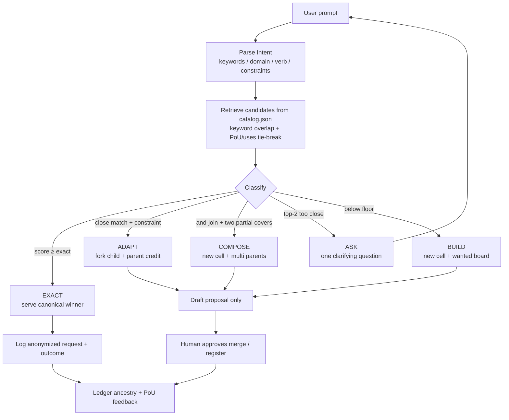

# Glean Router

**Status:** design + stdlib v0 prototype in this repo.  
**Ancestry:** child of [aurelio-labs/semantic-router](https://github.com/aurelio-labs/semantic-router) (MIT) with typed-schema ideas from [567-labs/instructor](https://github.com/567-labs/instructor) (MIT). Pointers only — see [RESEARCH.md](RESEARCH.md) and the upstream folders.  
**Consumes:** the live [`catalog.json`](../catalog.json). The labeled demo fixture is [sample_catalog.json](sample_catalog.json).

---

## 1. Plain overview

Today a person talks to AI and often rebuilds the same tool from scratch. The commons already holds proven cells (tools, playbooks, loops). The **Glean Router** is the brain that sits in front:

1. Listen to what you asked for (keywords + intent — not a mystery black box).
2. Search the ranked catalog.
3. If the right tool **already exists**, hand it to you in seconds.
4. If something is **close**, fork it as a child (credit the parent).
5. If **two tools cover parts**, propose a new combo cell (credit both parents).
6. If **nothing fits**, build it for you **and** leave it for the next person — because *if someone asks for it, someone else will*.

That is Timmy’s rule for the commons: start from what is proven, improve the winner, keep the credit trail.

Whitepaper anchors (quoted faithfully):

- “Usefulness becomes the new currency.” (sec 3.3)
- “AI as Co-Laborer, Not Master” (sec 3.4) — the Router **recommends and drafts**; humans approve merges, registration, rewards, and publishing.
- AI “Helps users create tools via voice or text (‘speak your app into existence’)” (sec 4.4) — Router is the first step of that speak-to-build path: find or draft, don’t pretend it already shipped.

Also: “Identifies duplicated ideas” (sec 4.4) — EXACT and ADAPT exist so we stop reinventing.

---

## 2. Typed decision tree

Inspired by Timmy’s **Jev / TypeSafe** idea (typed judgments + **code owns the tree** — verified as TypeSafe’s System One / Jev pattern; see RESEARCH.md) and by Aurelio **semantic-router** (explicit routes, confidence thresholds, hybrid keyword+meaning, deterministic dispatch).

### Schemas (v0 = dataclasses; v1 may use Instructor-shaped models)

**Intent** — what the user is asking (store anonymized fields by default, not raw private text):

| Field | Meaning |
| --- | --- |
| `keywords` | Normalized tokens from the prompt |
| `domain` | Coarse area (`invoice`, `plumbing`, `video`, …) |
| `task_verb` | What to do (`follow`, `schedule`, `draft`, …) |
| `constraints` | Segment / trade / locale flags |

**Match** — one catalog hit:

| Field | Meaning |
| --- | --- |
| `project_id` | Catalog id |
| `score` | 0–1 retrieval score |
| `pou_score` / `uses` | Proof of Use signals for ranking |
| `reasons` / `tags_hit` | Auditable why |

**Decision** — what to do next:

| `outcome` | Meaning |
| --- | --- |
| **EXACT** | Score ≥ exact threshold → serve **canonical winner** now |
| **ADAPT** | Close match → draft **child variant** with one parent |
| **COMPOSE** | Two+ cells cover parts (explicit “X and Y”) → new cell with **multiple parents** |
| **BUILD** | Nothing fits → draft **new** cell; log demand |
| **ASK** | Ambiguous top-2 → **one** clarifying question |

### Flow



### Thresholds (tunable, A/B-testable)

v0 defaults in `route.py`:

| Knob | Default | Role |
| --- | --- | --- |
| `EXACT_THRESHOLD` | 0.72 | Serve winner |
| `ADAPT_THRESHOLD` | 0.45 | Fork child |
| `COMPOSE_PART_THRESHOLD` | 0.32 | Minimum for a part |
| `ASK_AMBIGUITY_GAP` | 0.08 | Near-tie → ask |

These knobs are themselves commons experiments (see ANALYST.md): declare an experiment, split traffic, promote the threshold set that raises honest PoU — humans approve.

---

## 3. Demand signal (“if someone asks, someone else will”)

Every route call appends an **anonymized** request record (not raw private prompts by default):

```json
{
  "ts": "2026-11-06T16:20:00-05:00",
  "intent": {"keywords": ["invoice", "follow-up"], "domain": "invoice", "task_verb": "follow"},
  "outcome": "BUILD",
  "primary_id": null,
  "catalog_version": "<hash or updated field>"
}
```

- **Wanted board:** cluster repeated unmet (`BUILD`) intents by keyword signature; rank by count × recency.
- **First-builder credit:** when a wanted item is fulfilled, ledger notes the fulfiller + demand cluster id (ancestry still applies for any parents used).
- **PoU feedback:** outcomes feed Scorecard v0 signals (`PROOF-OF-USE.md`): served → reach (**R**), adopted/kept → depth/durability (**D**/**L**), reused → benefit proxy (**B**), router-improved picks → AI uplift (**A**). Never fabricate `uses`.

---

## 4. Human guardrails

Aligned with ANALYST.md / MCP.md / AGENTS.md:

- Router **recommends and drafts** only. No autonomous merge, no ledger rewrite, no reward minting.
- Humans approve: new cell registration, ADAPT/COMPOSE merges, promotions, publishing, payouts.
- **Privacy:** do not store raw prompts by default; store Intent fields. Opt-in if a user wants a transcript for debugging.
- **No fabricated usage.** Inflated PoU is grounds to reject a PR.
- **Fairness:** flag sudden spikes; prefer proven PoU over hype; credit ancestry on every fork/combo (70/20/10 proposal remains a proposal).
- Co-laborer, not master (whitepaper sec 3.4).

---

## 5. How it plugs in

| Layer | Now | Next |
| --- | --- | --- |
| CLI | `python3 router/route.py "…"` (live `catalog.json`); `python3 router/route.py --demo` (sample fixture) | Same |
| Catalog | Consumes `catalog.json` fields: `id,name,type,status,summary,tags,when_to_use,parents,ancestry,children,canonical_version,variants,uses,pou,how_to_change,upstream` | Rebuild on every change (cloud agent) |
| Agents | `llms.txt` should say: **call route first** before building from scratch | |
| MCP | Later: `route(prompt)` beside `list_projects` / `get_project` / `search` / `propose_change` ([MCP.md](../MCP.md)) | “Everything commons” — Claude, Grok, Cursor, any agent |
| Analyst | ADAPT/COMPOSE drafts enter fork → variant → experiment → decision | |

Intake for upstream parents follows [INTAKE.md](../INTAKE.md): pointer README under `upstream/…`, ledger credit, no copied code.

---

## 6. Prior art / inspiration (only what we verified)

See [RESEARCH.md](RESEARCH.md) for the full table and SPDX checks.

| Source | Role |
| --- | --- |
| **aurelio-labs/semantic-router** (MIT) | **Primary parent.** Intent/tool routes, confidence, hybrid keyword+semantic, threshold for none. |
| **567-labs/instructor** (MIT) | **Secondary parent.** Typed structured outputs for Intent/Decision when LLM parse is added. |
| **TypeSafe Jev** | Timmy’s inspiration: typed judgments; code owns the tree. No OSS repo to vendor; optional decision-model API. Semantic-router’s DecisionRouter can call Jev. |
| **lm-sys/RouteLLM** (Apache-2.0) | Cost routing strong↔weak LLM — **not** cell routing. Optional idea for v2 learned thresholds. |
| **llms.txt** (llmstxt.org) | Agent-oriented index convention. |
| **MCP Registry** | Discoverable tool catalogs for agents. |

v0 `route.py` **borrows ideas** from semantic-router (explicit routes, thresholds, keyword hybrid, deterministic classify). **No upstream source was copied.**

---

## 7. Phased plan

| Phase | What | Gate |
| --- | --- | --- |
| **v0** | Stdlib keyword + rules (`route.py`); sample catalog; anonymized request log schema; wanted board as sorted JSON | Human review of design + demo; Timmy yes before live repo / upstream pointers |
| **v1** | Optional embeddings / semantic-router as library **or** compatible encoder; Instructor-typed LLM intent parse; MCP `route` | Human review; license notices if dependency added; still recommend-only |
| **v2** | Learned routing from PoU outcomes (which decisions users kept); threshold A/B via Analyst | Human review; no autonomous promote |

Each phase stays free/easy where possible; open source parents preferred.

---

## 8. Prototype files in this folder

| Path | Purpose |
| --- | --- |
| `ROUTER.md` | This design |
| `RESEARCH.md` | Verified prior art + SPDX |
| `proposed-commons-entries.json` | Draft upstream registry objects |
| `sample_catalog.json` | Real commons-draft projects + labeled EXAMPLE cells |
| `route.py` | Stdlib router CLI |
| `test_route.py` | Quick unit tests |

Run:

```bash
python3 router/route.py --demo
python3 router/test_route.py
python3 router/route.py "agent loop"
```

---

## What this folder does not do

- No vendored semantic-router or instructor code
- No MCP server yet
- No autonomous merge, reward, or ledger rewrite
