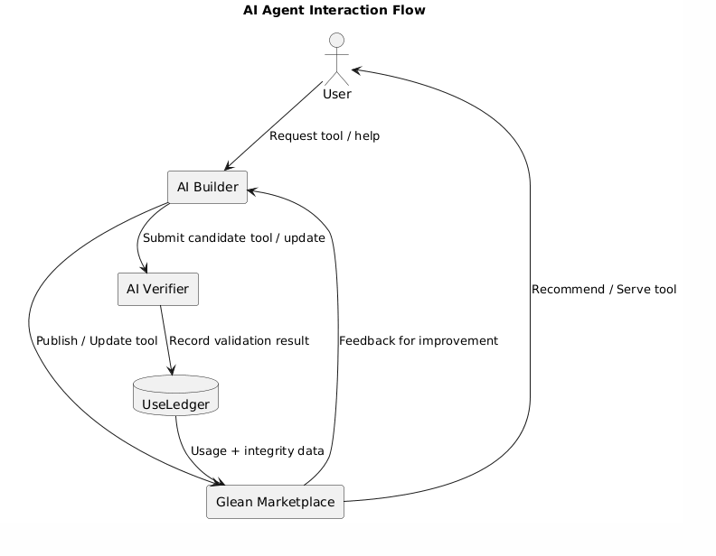
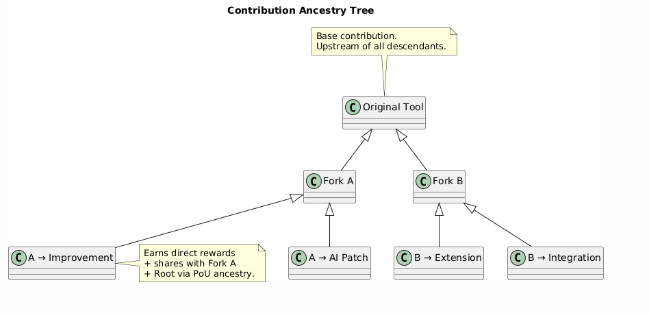
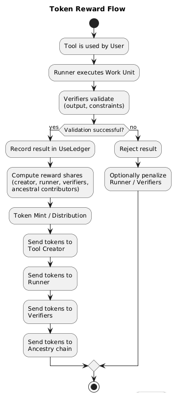
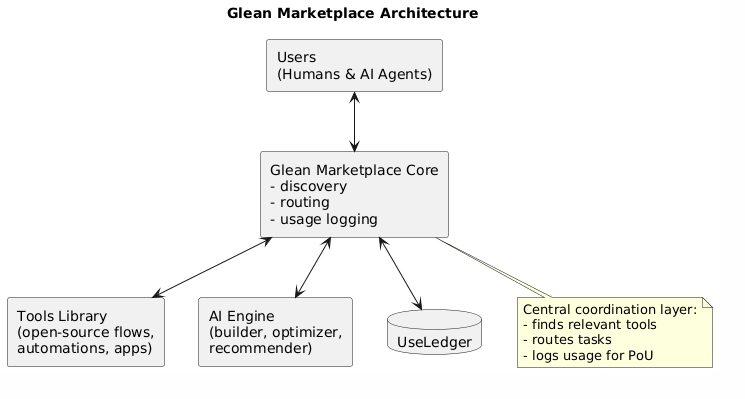
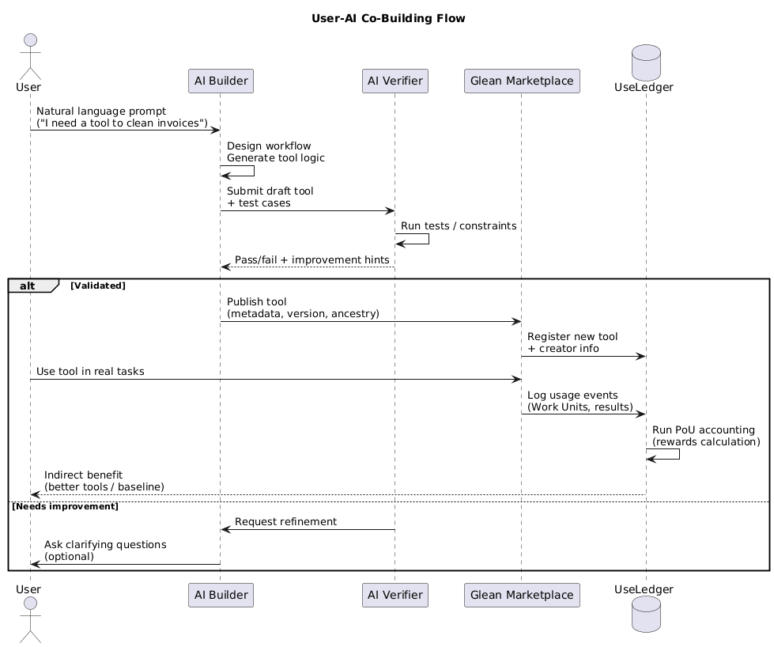

# THE GLEAN SYSTEM

## A Visionary Framework for a Human-Centered, AI-Augmented, Decentralized Economy

**Whitepaper (Visionary Edition)**  
**Draft 1.0 — 2025**  

---

## Abstract

The Glean System is a decentralized, AI-augmented ecosystem built to rebalance human life around freedom, contribution, and shared prosperity. It rejects the industrial-era model that forces individuals into rigid schedules, commutes, and corporate dependency. Instead, it proposes a digital commons powered by Proof of Use — a new economic principle where value is created and distributed based on how much human-helping tools, ideas, and services are actually used.

In the Glean System, every human is effectively “hired” by participating in the ecosystem. Contributors earn tokens by creating tools, solving problems, or helping others — and users benefit from a baseline of shared tools, analysis, knowledge, and automation. AI acts as a benevolent collaborator, continually improving the ecosystem and ensuring fair reward distribution.

The goal: empower humanity to live better lives, reclaim time, and build a world where contributions that deeply help people are rewarded above all else.

---

## 1. Introduction

For generations, human life has been shaped not by human needs, but by the needs of industrial systems. Rush-hour commutes, inflexible work schedules, burnout, debt cycles — these are artifacts of a world designed for machines, corporations, and economic throughput, not human flourishing.

Today, most people work more hours than ever, yet feel less free. Tools like Excel — incredibly useful yet proprietary — become indirect “taxes” humans pay to navigate their daily responsibilities. Industry dictates the rhythm of life.

But humanity now has a new ally: AI.

AI gives us the chance to design systems not around industry, but around human well-being — systems that automate drudgery, reward contribution, and give people back their most precious resource: time.

The Glean System is a step toward that future.

---

## 2. The Vision: A World Where Humans Are Free Again

Imagine a world where:

- You no longer burn an hour in traffic to reach a desk.
- Tasks that drain your life — invoices, spreadsheets, scheduling, follow-ups — happen automatically.
- Creativity, service, and contributions are rewarded fairly and transparently.
- Even the least advantaged have a stable digital foundation for income and opportunity.
- Communities, not corporations, own the tools they depend on.
- AI collaborates with mankind to build a future no individual could build alone.

The Glean System is designed to make this shift possible.

---

## 3. Core Philosophy

### 3.1 Humans First

Technology should serve humanity — not the other way around. The Glean System begins with the belief that human time, dignity, and freedom are the most valuable resources on Earth.

### 3.2 Decentralized Ownership

No single company owns the ecosystem. Every contribution is tracked publicly. Value flows to creators, not gatekeepers.

### 3.3 Proof of Use (PoU)

Usefulness becomes the new currency.

If you build something — an automation, a tool, a guide, a service — and others use it, you earn.

If millions use it, you prosper.

This flips the world’s incentives: no more corporate bureaucracy; pure human-helping value rewarded.

### 3.4 AI as Co-Laborer, Not Master

AI observes what humans build and improves it. AI attributes credit fairly. AI continues the work when humans rest. AI protects the commons.

This is a partnership — not competition.

---

## 4. The Glean System Architecture (High-Level Vision)

### 4.1 The Digital Commons

All tools live in an open-source ecosystem accessible to anyone. Think of a decentralized app store where everything is free to use, and creators are paid by the system.

### 4.2 Proof of Use Mechanism

The system tracks:

- How many people use a tool
- How deeply they use it
- How the tool improves life or reduces work
- How long it remains useful
- Whether AI adaptations improve its utility

Tokens are minted and distributed proportionally.

### 4.3 Contribution Chain

Every idea has an ancestry.

If a new tool is built on your idea:

- You are rewarded.
- The new creator is rewarded.
- The AI assisting both is rewarded.

Value flows “up the tree” to early contributors, similar to early investors — but ethical, transparent, and fair.

### 4.4 AI Backbone

AI:

- Helps users create tools via voice or text (“speak your app into existence”)
- Identifies duplicated ideas
- Auto-improves tools for usefulness
- Allocates rewards
- Moderates fairness
- Ensures the ecosystem evolves toward maximum benefit for humanity

This is an economy that gets smarter on its own.

---

## 5. Token Economy (Visionary)

### 5.1 Universal Baseline

Everyone who participates receives a base level of tokens — a digital “floor” ensuring stability and access.

### 5.2 Contribution Rewards

You can earn more by:

- Building tools
- Contributing ideas
- Fixing bugs
- Helping others
- Collaborating
- Teaching
- Innovating
- Improving an existing solution

### 5.3 Perpetual Value

If your contribution becomes foundational — used by millions over time — you earn continually. This encourages early pioneers and rewards the long-term impact of great ideas.

### 5.4 Token Uses

Tokens can be exchanged for:

- Services within the ecosystem
- Real-world currency (through exchanges)
- Access to advanced AI compute
- Community-funded initiatives
- Goods created by other contributors

---

## 6. Governance Model: Community Over Corporations

### 6.1 Reputation-Weighted Voting

Not based on wealth — but based on:

- Contributions
- Positive impact
- Community trust
- Historical usefulness

### 6.2 Transparent Ledger

Every proposal, vote, and outcome is open.

### 6.3 AI-Assisted Fairness

AI helps detect:

- Abuse
- Bias
- Disproportionate influence
- Systemic issues
- Unfair token manipulation

This ensures a stable, benevolent ecosystem.

---

## 7. Transformative Societal Benefits

### 7.1 More Human Time

Automation + AI frees humans to:

- Be with family
- Create
- Rest
- Learn
- Heal
- Pursue meaningful work

### 7.2 Reduced Economic Stress

Everyone has a basic digital income floor. No one is left behind.

### 7.3 Fair Reward Distribution

People who build value get value — not corporations.

### 7.4 Lower Barriers to Innovation

If you can think it, you can build it. If you build it, you can be rewarded. If you use it, you contribute to the ecosystem.

### 7.5 Global Collaboration

Borders don’t matter. Location doesn’t matter. Everyone can contribute meaningfully.

### 7.6 AI Alignment through Usefulness

AI becomes aligned with actual human needs because it learns from real human use — not corporate objectives.

---

## 8. Implementation Roadmap (Visionary)

### Phase 1 — Ideation

- Define key components
- Build foundational AI assistant
- Form global advisory group
- Open-source repo setup

### Phase 2 — Prototype

- MVP: “Speak-to-Build” AI tool creator
- Early Proof-of-Use tracking
- First utility apps (Excel-like system replacements)
- Token simulation

### Phase 3 — Early Network

- Launch Glean marketplace
- Begin open contribution
- AI begins improving tools
- Token minting goes live

### Phase 4 — Decentralization

- Community governance tokens
- Autonomous value distribution
- AI-led system optimization

### Phase 5 — Global Adoption

- Third-party integrations
- Cross-ecosystem collaboration
- Economic breakthroughs
- International scaling

---

## 9. Conclusion

The Glean System is not just a technology — it is a new economic philosophy. A reimagining of how humanity works, earns, collaborates, and lives. By replacing industrial compliance with human-centered contribution, by replacing corporate ownership with shared ownership, and by replacing competition for survival with collaboration for prosperity, the Glean System offers a path to a freer, fairer, more dignified future.

What Bitcoin did for money, the Glean System can do for human work, creativity, and contribution.

This is the beginning of a new world — one built not for machines, companies, or markets, but for humanity.

---

## Please see diagrams below:

### Diagram 1 — AI Agent Interaction Flow

### Diagram 2 — Contribution Ancestry Tree

### Diagram 3 — Token Reward Flow

### Diagram 4 — Glean Marketplace Architecture

### Diagram 5 — User-AI Co-Building Flow

---

*Source files in this folder:*

- [`glean-system-whitepaper.docx`](glean-system-whitepaper.docx) — original Draft 1.0 document
- [`diagrams/`](diagrams/) — figures extracted from the original `.docx`
